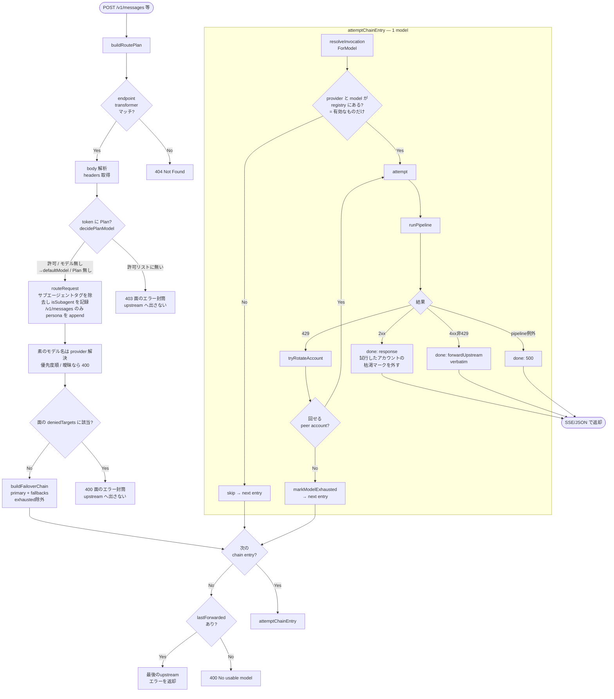
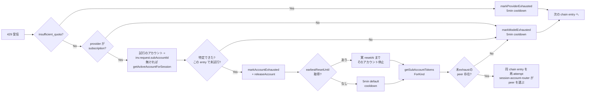
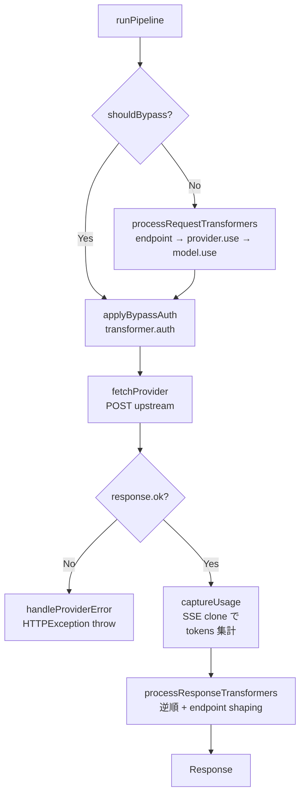

# /v1/* リクエスト処理フロー

## 目的

`POST /v1/*` で Claude Code（または互換クライアント）から入ってきたリクエストが、Plan のモデル判定 → failover chain → upstream provider 呼び出しまでどう流れるかを可視化する。
特に **multi-account subscription での 429 ローテーション**、**upstream へ出さずに返す 403 / 400**、**無効な target のスキップ** を取りこぼさないこと。
リクエストの行き先の決まり方（Plan のモデル判定・素のモデル名の解決・deniedTargets・scheduler の snapshot）は [routing.md](./routing.md) にまとめてある。本書はそれがリクエストの流れのどこに入るかを描く。

実装は以下に分散している:

- `src/api/v1/route.ts` — HTTP ハンドラ / chain ループ
- `src/api/v1/route-plan.ts` — `buildRoutePlan`（リクエストごとに1回。許可されないモデルの 403 と拒否の 400 もここで返す）
- `src/api/v1/candidate-chain.ts` — `buildFailoverChain`（試す候補の順序）
- `src/api/v1/invocation.ts` — `resolveInvocationForModel`（候補1件 → 実行可能な invocation）
- `src/api/v1/chain-failover.ts` — `attemptChainEntry` / `tryRotateAccount`
- `src/llms/router.ts` — `routeRequest`（サブエージェントタグの除去と persona の append）
- `src/services/plan-model.ts` — `decidePlanModel`（Plan のモデル判定）
- `src/llms/pipeline.ts` — `runPipeline` / `handleProviderError`

> **前提**: Rialto は行き先を選ばない。呼び出し側が書いたモデル（`provider,model`、または素のモデル名）がそのまま
> 候補になる。Plan を持つ token だけが、許可リストに無いモデルを 403 で拒否され、モデルを書かなかったときに
> `defaultModel` を受ける。サブエージェントタグはどの受け口でも最初に取り除かれる。シナリオ・レーン・ティア・
> `routed` モードは無い（[migration-v3.md](../guides/migration-v3.md) §9）。

## 全体フロー

403 と 400 はどちらも `buildRoutePlan` が返し、chain ループにも upstream にも届かない。403 は Plan に載っていない
モデルを名指しした呼び出しへの答えで、メッセージに拒否したモデルと許可リストが入る。使用枠の 429 はそれより前、
認証の段（`api-key-auth.ts`）で返る — そのため 403 で拒否されたリクエストも 1 件に数えられる。

## 429 のときの分岐

`attemptChainEntry` 内のループで起こる、subscription multi-account 対応のローテーション。

- **どのアカウントが 429 を受けたか**は、OAuth transformer が送信前にその試行の request へ
  stamp した `subAccountId` で決める。session 単位の「最後に選んだアカウント」は同じ session の
  並行リクエストに上書きされうるので、transformer がアカウントを解決する前に失敗した試行の
  フォールバックとしてしか使わない。
- peer が尽きたときに塞ぐのは **その `(provider, model)` だけ**である。プロバイダ全体を塞ぐのは
  `insufficient_quota`（api_key の課金上限。同 provider のどのモデルでも同じ 429 になる）のときだけ。
- 成功した試行は、その試行のアカウントに枯渇マークが残っていれば外す（成功したのならマークは誤り）。

ローテーションは 1 chain entry あたり最大 `MAX_ACCOUNT_ROTATIONS = 10` 回までで打ち切る（防御的キャップ）。

## pipeline 内部

`handleProviderError` がスローする `HTTPException` の message は
`Error from provider(<name>,<model>: <status>): <rawBody>` 固定形式。
`src/api/v1/upstream-error.ts` の `forwardUpstreamError` が `PROVIDER_ERR_RE` で
逆パースして upstream の生 body を verbatim 返す。

## fallback の絞り込み

**送る前**に絞るのは `buildRoutePlan` と `buildFailoverChain` の 2 か所だけである。`buildRoutePlan` は、素のモデル名を
持つ有効なプロバイダを優先度順に並べ（Plan があれば Plan が載せるプロバイダに限る）、`deniedTargets` に該当するものを
落とす。`buildFailoverChain` が落とすのは **枯渇マークの付いた候補だけ**である（全候補が枯渇していれば元の順序を
そのまま返す — 窓が転がっている可能性に賭ける）。かつてあったゲートは廃止された。

| かつてのゲート | いま |
|--------|------|
| **auth_mode gate**（primary と異なる auth_mode の fallback を除外） | **廃止。** 素のモデル名を複数のプロバイダが持っていれば、優先度順に辿る。subscription の後ろに api_key のプロバイダが来てもよい。走らせたくなければ `provider,model` で名指しするか、Plan にそのプロバイダを載せない |
| **same-provider gate**（primary と同じ provider の fallback を除外） | **廃止。** 枯渇は `(provider, model)` 単位でマークされる。ただし 5h / weekly の窓は account 単位なので、account が枯れた 429 では別 model でも同じ account で 429 になる |
| **無効な provider / model** | そもそも候補にならない。registry は有効な provider の有効な model しか持たないので、手で名指しした pair も `resolveInvocationForModel` が null で返して次へ進む |
| **ルートのゲート**（on/off・エイリアス・web 検索・context・quota・error rate） | **廃止。** ルートそのものが無い。quota で止めることはせず、上流の 429 に反応する |

| 場面 | 挙動 |
|------|------|
| bare 名 `claude-opus-4-8` を受信 | そのモデルを有効なプロバイダがちょうど 1 つ持っていればそこへ送る。複数あれば Providers → Priorities の優先度順で、優先度が無ければ 400。0 件なら送らない（400 `No usable model`） |
| `provider,model` を受信 | そのまま宛先になる。OpenAI 互換面が `/v1/models` の id をそのまま投げ返せるのはこの経路。fallback は無い |
| Plan に無いモデルを受信 | 403（面のエラー封筒）。`defaultModel` へは振り替えない |
| モデルを書いていないリクエスト | Plan があれば `defaultModel`。無ければ 400 `Missing model in request body` |
| primary が subscription で 429 | `tryRotateAccount` で peer サブアカへ回し、尽きたらその model に枯渇マーク → chain の**次のエントリ**へ（素のモデル名を持つ次のプロバイダ） |
| primary が subscription で 429、fallback 無し | チェーンは primary 1 件のみ。回せなければ 429 を verbatim 返却 |
| primary が api_key で 429 | その model に枯渇マーク → 次のエントリへ。`insufficient_quota` のときだけ provider ごと塞ぐ |
| 「サブスク 5h 枯渇したら api_key にフォールバック」を **明示的に** したい | 同じモデルを持つ api_key のプロバイダを Priorities の 2 番目に置き、素のモデル名で呼ぶ |

## 代表シナリオ早見表

| # | 状況 | 流れ |
|---|------|------|
| 1 | `claude-code,claude-sonnet-4-6` を名指しした短いリクエストが正常応答 | Plan が許していれば `body.model` はそのまま → `attemptChainEntry` → 2xx → SSE 返却 |
| 2 | 同上で **5h 窓 429**、サブアカ 3 つあり 1 つだけ枯渇 | 429 → `tryRotateAccount` で当該アカ exhaust → 同 entry 再試行 → peer アカで成功 |
| 3 | 全サブアカが 5h 枯渇 | 429 → 全アカ exhaust → その model に `markModelExhausted` → 素のモデル名なら次のプロバイダ、名指しなら 429 を verbatim 返却 |
| 4 | 直前のリクエストで 429 を食って provider / model に exhausted マークが付いている | `buildFailoverChain` がマークのある候補を外して次を primary にする。全部マーク済みなら元の順のまま試す。マークは 429 レスポンスの実 resetAt（無ければ 5 分）で自動失効する。**それより早く外れるのは手動 Refresh と Codex のリセット消費のとき** — 最新の使用量で上限を下回ったアカウントのマークと、最新の値で配信できると分かったモデルのマークを外し、quota snapshot をすぐ作り直す（下の状態ストア表） |
| 5 | 素のモデル名 `claude-opus-4-8` で、Plan が `claude-code,claude-opus-4-8` を許している | そのモデルを持つプロバイダへ解決する（1 つならそこ、複数なら優先度順）。thinking の有無や effort は行き先に影響しない |
| 6 | 同じ model を api_key の `anthropic` も hosts している | 素のモデル名なら Priorities の順。優先度が未設定なら曖昧として 400。`provider,model` で名指しすれば曖昧さは無い |
| 7 | subscription primary が 429、同じモデルを持つ api_key プロバイダが 2 番目 | 優先度順に api_key へも落ちる。全部枯渇なら最後の 429 を verbatim 返却 |
| 8 | `anthropic` provider が **api_key 未設定** | registry がこの provider を warn 付きでスキップ → その provider の候補は `resolveInvocationForModel` が null → 次へ |
| 9 | inbound `body.model` に `provider,model` 形式（コンマ）が来た | Plan が許していればそのまま宛先として使われる。fallback は無い。※ `provider,model` は下流の内部表現としても引き続き使用 |
| 10 | upstream が 401/403 (subscription) | `handleProviderError` が「OAuth 期限切れ → CLI 再ログイン」と warn、HTTPException として上に伝播 → 429 ではないので verbatim 返却（rotate なし）|
| 11 | upstream が 400 で `effort` 不一致 | `attempt` 内で `bestSupportedLevel` を読んで effort 差し替え → 同 model に 1 回だけ retry。差し替え先はメッセージに挙がった対応レベルのうち `max` を除いた最高のもので、`max` しか挙がっていなければ補正せず 400 をそのまま返す（Rialto が勝手に最も高いレベルへ上げない） |
| 12 | 全 fallback exhaust | `lastForwarded` (最後の 429 body) を verbatim 返却 |
| 13 | `provider,model` が Providers 画面で無効化した model / provider を指す | registry に無いので `resolveInvocationForModel` が null → skip。全 entry が該当すれば 400 `No usable model`。手で名指ししても転送されない |
| 14 | token の Plan が `claude-code,claude-sonnet-4-6` だけを許していて、`claude-opus-4-8` を名指しした | 403。`Model "claude-opus-4-8" is not allowed for this token. Allowed models: claude-code,claude-sonnet-4-6.` が面のエラー封筒で返る |
| 15 | 同じ Plan で `model` を書かずに投げた | `defaultModel` に置き換わる（`RequestLog.requestedModel` は空のまま） |
| 16 | `<RIALTO-SUBAGENT-MODEL>` 付きのリクエスト | タグは除去され、`RequestLog.isSubagent` が立つ。行き先は変わらない |

## 関連する状態ストア

| ストア | 役割 | 失効条件 |
|--------|------|----------|
| `failover-state` (`isProviderExhausted` / `isAccountExhausted` / `isModelExhausted` / `exhaustedUntil`) | provider / sub-account / (provider, model) 単位の枯渇フラグ。`buildFailoverChain` が読む。**プロセスローカル**で、複数インスタンス間では共有されない | `markXxxExhausted(until?)` の `until` 時刻 or デフォルト 5min。成功した試行はそのアカウントのマークを外す。加えて手動 Refresh（`POST /api/subscriptions/refresh`、接続時・Codex のリセット消費後の再取得も同じ経路）が、最新の値を取れたアカウントについて `accountHasHardLimitHit` で判定し直して外す — アカウントのマークはアカウント全体の窓で、モデルのマークはそのモデルに効く窓（Fable の週次窓を含む）で判定する。provider のマーク（`insufficient_quota`）は外さない |
| `routing-scheduler` (`getRoutingSnapshot`) | quota snapshot。有効なサブスクプロバイダの有効なモデルごとに `{ exhausted, remainingBudgetPct, projectedPct, resetAt }`。chain walker の `providerExhaustionOf`（アカウントが全部尽きたプロバイダへ送らない）と、適応的 reasoning effort のペース（`projectedPct`）が読む。snapshot に無い target（api_key プロバイダ、初回 tick 前）は止めない | 5 分ごとの tick で作り直す。手動 Refresh・Codex のリセット消費・モデルの ON/OFF の後は `republishRoutingSnapshot()` が、実行中の tick の後にもう 1 回 tick を走らせる（tick は重ならない） |
| `session-account-router` (`getActiveAccountForSession`) | session ↔ 選択 sub-account の sticky マップ | `releaseAccountForSession` で剥がす |
| `subaccount-usage-store` (`getPerAccountUsage`) | DB の `SubAccountUsage` 行をキャッシュ | 周期 polling で更新 |
| `usage-service` (`getKindWindowHeadroom`) | weekly / 5h ウィンドウのキャッシュ。`getKindWindowHeadroom` の呼び出し元はテストだけ | 周期 polling で更新 |

## ログ整合

- `[provider_response_error]` の `body` は `JSON.parse` で構造化されてから出力されるので
  pino 上はネストされたオブジェクトとして読める（escape まみれの文字列にはならない）。
- `ProviderRegistry.registerFromConfig` は api_key/api_base_url 欠落時に
  `provider 'xxx' skipped — missing required fields: ...` を **warn** で出すので、
  「config 上は居るのに chain walker が見つけられない」状況を即特定できる。
